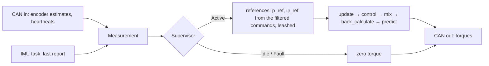

# Plant and design

The code is [include/balance_controller.hpp](../include/balance_controller.hpp). The SIL [sil/balance_sil.cpp](../sil/balance_sil.cpp) integrates the nonlinear equations below and closes the loop around the same `bot::Controller` the firmware runs.

## Coordinates

Pitch plane: $`p`$ is the axle's forward travel, $`\theta`$ the body's lean from vertical (forward positive), and $`\tau = \tau_R + \tau_L`$ the sum of the motor torques on the wheels. The motor's reaction is $`-\tau`$ on the body. Yaw: $`\psi`$ is counter-clockwise from above, and $`\Delta\tau = \tau_R - \tau_L`$.

| Symbol | Nameplate field | Meaning |
| --- | --- | --- |
| $`r`$ | `wheel_radius` | wheel radius |
| $`d`$ | `track_width` | distance between the tire contact patches |
| $`\ell`$ | `com_height − wheel_radius` | body CoM above the axle |
| $`M`$, $`J_b`$ | `body_mass`, `body_inertia` | everything that pitches; its inertia about its own CoM |
| $`m_w`$, $`J_w`$ | `wheel_mass`, `wheel_inertia` | per side: everything on the axle; the rotating part about the axle |
| $`J_z`$ | `yaw_inertia` | whole bot about the vertical, wheels not spinning |

A hub motor's stator rides on the axle but does not spin, so it counts in $`m_w`$ and not in $`J_w`$.

## Pitch plane

The wheels roll without slipping, so a wheel turns $`p/r`$ against the ground and $`p/r - \theta`$ against the body. The motor torque does work through that relative angle, so the generalized forces on $`(p, \theta)`$ are $`(\tau/r,\ -\tau)`$. Let

```math
a = M + 2\left(m_w + \frac{J_w}{r^2}\right), \qquad b = M\ell, \qquad c = J_b + M\ell^2
```

$`a`$ is the translating mass with the wheel inertia reflected through $`r`$, and $`c`$ is the body's pitch inertia about the axle (`pitch_mass()`). The kinetic and potential energies are

```math
T = \tfrac{1}{2}\, a\, \dot p^2 + b \cos\theta\, \dot p\, \dot\theta + \tfrac{1}{2}\, c\, \dot\theta^2, \qquad V = b\, g \cos\theta
```

and Lagrange's equations give

```math
\begin{aligned}
a\, \ddot p + b \cos\theta\, \ddot\theta - b \sin\theta\, \dot\theta^2 &= \tau / r \\
b \cos\theta\, \ddot p + c\, \ddot\theta - b\, g \sin\theta &= -\tau
\end{aligned}
```

The SIL solves this 2×2 system at every RK4 stage, with viscous friction between each wheel and the body subtracted from its motor torque.

Linearized about upright ($`\sin\theta \approx \theta`$, $`\cos\theta \approx 1`$, $`\dot\theta^2 \approx 0`$), with $`D = ac - b^2`$:

```math
\begin{aligned}
\ddot p &= \frac{-b^2 g\, \theta + (c/r + b)\, \tau}{D} \\
\ddot\theta &= \frac{a b g\, \theta - (a + b/r)\, \tau}{D}
\end{aligned}
```

That is `pitch_plant()`:

```math
\frac{d}{dt}\begin{bmatrix} p \\ v \\ \theta \\ \omega \end{bmatrix}
=
\begin{bmatrix}
0 & 1 & 0 & 0 \\
0 & 0 & -b^2 g / D & 0 \\
0 & 0 & 0 & 1 \\
0 & 0 & a b g / D & 0
\end{bmatrix}
\begin{bmatrix} p \\ v \\ \theta \\ \omega \end{bmatrix}
+
\begin{bmatrix} 0 \\ (c/r + b)/D \\ 0 \\ -(a + b/r)/D \end{bmatrix} \tau,
\qquad y = p
```

On the measured nameplate (below) the fall is unstable at $`\lambda = \sqrt{abg/D} = 3.66`$ rad/s. Torque to position has zeros at

```math
s = \pm\sqrt{\frac{b g}{c + b r}} = \pm 3.3 \text{ rad/s}
```

To roll forward, the wheels first roll back to lean the body over. That right-half-plane zero caps how fast the position loop can be. The tall, light body puts it low: position settles in seconds, not fractions of one.

## The nameplate, measured

The pitch plane only sees $`a`$, $`b`$ and $`c`$. Two of them are measured; `body_mass` only splits $`b`$ and $`c`$ into `com_height` and `body_inertia`.

- **$`b`$ from the whole bot's CoM.** The wheels' mass sits on the axle, so the whole bot's mass moment about the axle is the body's: $`b = (M + 2m_w)\, h`$, with $`h`$ the whole bot's CoM above the axle. Balanced on a rod: $`h`$ = 4.25 in, so $`b`$ = 5.4 kg × 0.108 m = 0.583 kg·m.
- **$`c`$ from a drop test.** With the drives idle, the bot released from about ±13° falls freely, the wheels rolling. Six drops fit $`\ddot\theta = \lambda^2 \sin(\theta - \theta_\text{eq})`$ to 1–8 mrad with $`\lambda`$ = 3.66 rad/s, so

  ```math
  c = \frac{b^2}{a} + \frac{b\, g}{\lambda^2} = 0.47 \text{ kg·m}^2
  ```

- **The trim** is the same fit's $`\theta_\text{eq}`$ = +0.004 rad: the IMU reading with the CoM over the axle.

## Traction

A wheel carries half the bot's weight, so it slips past $`\tau_\max = \mu\, \tfrac{1}{2}(M + 2m_w)\, g\, r`$: about 2 N·m at $`\mu \approx 0.9`$ (`kWheelTorqueMax`). A slipping wheel reads as speed the bot does not have, and the speed feedback then drives it harder: on the first ground test, with a 5 N·m cap, both wheels spun at the cap for seconds.

## Yaw

Each wheel pushes the ground with $`\tau_i / r`$ at $`\pm d/2`$ from the centre line, so the yaw moment is $`(d/2r)\, \Delta\tau`$. Turning also spins the wheels at $`\pm \dot\psi\, d / 2r`$, which adds to the inertia (`yaw_inertia()`):

```math
J_{z,\text{eff}}\, \ddot\psi = \frac{d}{2r}\, \Delta\tau, \qquad J_{z,\text{eff}} = J_z + \frac{J_w\, d^2}{2 r^2}
```

`yaw_plant()`: $`x = [\psi,\ \dot\psi]`$, $`u = \Delta\tau`$, $`y = \psi`$. Pitch and yaw are decoupled; the coupling from turning while driving is left out.

## Measurement

The ODrive encoder reads the rotor against the stator, which is the wheel against the body. With $`\varphi_R`$, $`\varphi_L`$ the two encoder angles (forward positive, the left motor's sign flipped in `main.cpp`):

```math
\begin{aligned}
p &= r \left( \frac{\varphi_R + \varphi_L}{2} + \theta \right), &
v &= r \left( \frac{\dot\varphi_R + \dot\varphi_L}{2} + \omega \right) \\
\psi &= \frac{r}{d} \left( \varphi_R - \varphi_L \right), &
\dot\psi &= \frac{r}{d} \left( \dot\varphi_R - \dot\varphi_L \right)
\end{aligned}
```

$`\theta`$ cancels from the heading. The IMU is mounted on its side: its x axis is the pitch axis and the game rotation vector reads a roll $`\phi = 90^\circ`$ upright, so $`\theta = \phi - 90^\circ - \theta_\text{trim}`$ with $`\theta_\text{trim}`$ = `kPitchTrim`, and $`\omega`$ is its gyro x. Heading comes from odometry, not the IMU, so it does not depend on the IMU's mounting.

## Design

Each axis is a `design::lqi` on the continuous plant sampled at $`T_s = 10`$ ms: ZOH for the dynamics, Van Loan for the cost, so the weights are in continuous time and keep their meaning if the rate changes. The integrator is on the measured output, position for pitch and heading for yaw:

```math
\dot\xi = y_\text{ref} - y, \qquad J = \int_0^\infty \left( x^\top Q\, x + Q_\xi\, \xi^2 + R\, u^2 \right) dt
```

It removes the steady error that a CoM offset, an IMU mount error, a slope or friction would otherwise leave. The weights are Bryson's, $`Q_{ii} = 1 / x_{i,\max}^2`$ and $`R = 1 / u_\max^2`$, and the comments next to them give the excursions. The law runs about the reference, with the speed command as velocity feedforward:

```math
u = -K \begin{bmatrix} x - x^* \\ \xi \end{bmatrix}, \qquad x^* = \begin{bmatrix} p_\text{ref} & v_\text{cmd} & 0 & 0 \end{bmatrix}^\top
```

Pitch carries the measured delay (below, "Identification on the bot"): its design runs on `pitch_model()`, the plant sampled at $`T_s`$ with the torque arriving $`\theta_d`$ = `kDelay` = 22 ms late, which `discretize(…, InputDelay<3>{θ_d})` writes as three registers of the torques already sent. The law measures them like any other state, so it reads $`[p, v, \theta, \omega, \tau_{k-1}, \tau_{k-2}, \tau_{k-3}]`$ and subtracts part of what is still on its way:

```math
\tau_k = -K \begin{bmatrix} x_k - x^* \\ \tau_{k-1} \\ \tau_{k-2} \\ \tau_{k-3} \\ \xi_k \end{bmatrix}
```

A design on a sampled model takes its cost per step, so the weights are the continuous ones times $`T_s`$, with none on the registers: without the delay that gives the sampled-continuous gains within 1 %. Yaw stays on its delay-free design.

| Pitch closed loop, on the model | Pole |
| --- | --- |
| lean | 30 rad/s |
| position | 2.1 rad/s pair, $`\zeta = 0.62`$, and 1.9 rad/s |
| integral | 0.7 rad/s |

The weight on $`\omega`$ is high (128) for a reason the model does not show: with 4, the bot rang at about 4 rad/s with $`\zeta \approx 0.25`$ after a push, and raising it slowed the ring and damped it. The identification below explains why the model cannot see that.

## The tick



- **Supervisor:** Idle engages once the bot has been held within 5° for 2 s with fresh IMU data and both drives healthy. Active drops to Idle past 30° or on an axis error, and to Fault (latched) when the IMU goes quiet.
- **References:** on engage they start at the measured pose and the integrators clear, so the bot holds the spot it was let go at. The speed and yaw-rate commands pass a 0.5 Hz low-pass and integrate into the references, which a push drags at most a leash $`L`$ = `kLeash` behind the bot, so a big shove moves the hold point instead of winding up a large catch-up:

  ```math
  p_\text{ref} \leftarrow \operatorname{clamp}\left( p_\text{ref} + v_\text{cmd}\, T_s,\ p - L,\ p + L \right)
  ```

- **Mixer:** pitch comes first, steering gets what that leaves on each wheel, with $`\tau_\max`$ = `kWheelTorqueMax`:

  ```math
  |\tau| \le 2\tau_\max, \qquad |\Delta\tau| \le 2\tau_\max - |\tau|, \qquad \tau_R = \frac{\tau + \Delta\tau}{2}, \quad \tau_L = \frac{\tau - \Delta\tau}{2}
  ```

  The torques actually applied go back to each law (`back_calculate`), so the integrators do not wind up against the clamp.

## Robustness check

The SIL runs its script (hold, engage, release at 2°, push, drive, turn, tip over) twice: on the nameplate with the torque reaching the wheels 22 ms late, and on a plant 20 % heavier and taller with 20 % lighter wheels, a 2° IMU mount error and the torque 32 ms late, a period more than the design carries. Then it linearizes the pitch loop with the torque 32 ms late, a truth model with four registers around the law's three,

```math
z_k = \begin{bmatrix} x_k \\ \tau_{k-1} \\ \vdots \\ \tau_{k-4} \\ \xi_k \end{bmatrix}, \qquad u_k = -K \begin{bmatrix} x_k \\ \tau_{k-1} \\ \tau_{k-2} \\ \tau_{k-3} \\ \xi_k \end{bmatrix},
```

on all 16 corners of ±20 % on body mass, body inertia, CoM height and wheel inertia, and checks that every closed-loop pole has $`|z| < 1`$. On the current design the largest is 0.995. The script's push is 0.5 N·s: traction caps the torque at 2 N·m a wheel, and much more knocks the bot over. After the drive at 0.5 m/s it allows 6 s to stop, for the slow position loop.

After measuring the real bot, put the numbers in `Nameplate` and rerun the SIL. If a check fails, slow the lean (raise $`R`$) before anything else.

## Identification on the bot

The control tick goes out on CAN (README, "CAN log"), so a USB-CAN adapter records the loop at 100 Hz. To see the plant inside the closed loop, `kExcitation` in `main.cpp` adds a known torque $`r_k`$ to both wheels while the bot balances: a PRBS9 of ±0.3 or ±0.8 N·m, a new bit every 20 ms, flat to about 25 Hz. $`r`$ is uncorrelated with the hand, the floor and the sensor noise, so the plant from the torque as sent to the lean is the ratio of two cross-spectra (Welch, one PRBS period per segment):

```math
P_{\theta\tau}(j\omega) = \frac{S_{r\theta}(j\omega)}{S_{r\tau}(j\omega)}
```

and likewise to the axle speed and to the wheel against the body. Against the linearized model above:

- **Above about 2 Hz** the bot is the rigid model with three corrections, fitted on both paths at ±0.8 N·m from 1.5 to 10 Hz: the motors deliver 0.88 of the torque asked; the translating mass is 13.4 kg, not 7.2 (as if each wheel had 0.027 kg·m², not 0.006: friction the drive still has to move, most likely); and the response is 22 ms late, from the torque command to the IMU reading, a third of it the drives' 100 rad/s current loop. With $`c`$ held to the drop test, the fit's error is 0.23 in log magnitude against 0.78 for the nameplate.
- **Below about 2 Hz** the drivetrain is stiff: the lean, the axle and the wheel against the body all move 5 to 20 times less than the model per N·m, with up to +100° of lead, and the response grows toward the model as the excitation grows from ±0.3 to ±0.8 N·m. That is stiction or the hub motors' cogging holding the wheel to the body at small motions, which no linear model of this plant has. It is why the ring is not in the SIL.
- **The IMU is not the cause:** the game rotation vector's pitch matches the integral of its own gyro from 0.4 to 12 Hz within 7 % and 17°, so the fusion does not mistake the axle's acceleration for lean.
- **Anticogging** calibrated against a startup-relative position (the encoder's index does not reach the drive) made the low end stiffer still, so it is off.

The pitch design now carries the 22 ms delay (Design, above). What follows from the rest: the fitted torque gain and mass in the model, and an input disturbance estimated by an OFLQG in place of the integral, which takes a stuck drivetrain as a slowly varying torque.
