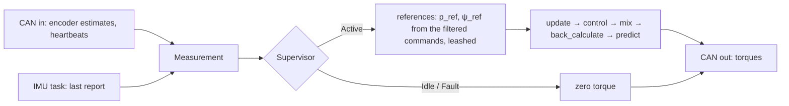

# Plant and design

The code is [src/balance_controller.hpp](../src/balance_controller.hpp). The SIL [sil/balance_sil.cpp](../sil/balance_sil.cpp) integrates the nonlinear equations below and closes the loop around the same `bot::Controller` the firmware runs.

## Coordinates

Pitch plane: $`p`$ is the axle's forward travel, $`\theta`$ the body's lean from vertical (forward positive), and $`\tau = \tau_R + \tau_L`$ the sum of the motor torques on the wheels. The motor's reaction is $`-\tau`$ on the body. Yaw: $`\psi`$ is counter-clockwise from above, and $`\Delta\tau = \tau_R - \tau_L`$.

| Symbol | Nameplate field | Meaning |
| --- | --- | --- |
| $`r`$ | `wheel_radius` | wheel radius |
| $`d`$ | `track_width` | distance between the tire contact patches |
| $`\ell`$ | `com_height − wheel_radius` | body CoM above the axle |
| $`M`$, $`J_b`$ | `body_mass`, `body_inertia` | everything that pitches; its inertia about its own CoM |
| $`m_w`$, $`J_w`$ | `wheel_mass`, `wheel_inertia` | per side: everything on the axle; the rotating part about the axle |
| $`J_z`$ | `yaw_inertia` | whole bot about the vertical, wheels not spinning |

A hub motor's stator rides on the axle but does not spin, so it counts in $`m_w`$ and not in $`J_w`$.

## Pitch plane

The wheels roll without slipping, so a wheel turns $`p/r`$ against the ground and $`p/r - \theta`$ against the body. The motor torque does work through that relative angle, so the generalized forces on $`(p, \theta)`$ are $`(\tau/r,\ -\tau)`$. Let

```math
a = M + 2\left(m_w + \frac{J_w}{r^2}\right), \qquad b = M\ell, \qquad c = J_b + M\ell^2
```

$`a`$ is the translating mass with the wheel inertia reflected through $`r`$, and $`c`$ is the body's pitch inertia about the axle (`pitch_mass()`). The kinetic and potential energies are

```math
T = \tfrac{1}{2}\, a\, \dot p^2 + b \cos\theta\, \dot p\, \dot\theta + \tfrac{1}{2}\, c\, \dot\theta^2, \qquad V = b\, g \cos\theta
```

and Lagrange's equations give

```math
\begin{aligned}
a\, \ddot p + b \cos\theta\, \ddot\theta - b \sin\theta\, \dot\theta^2 &= \tau / r \\
b \cos\theta\, \ddot p + c\, \ddot\theta - b\, g \sin\theta &= -\tau
\end{aligned}
```

The SIL solves this 2×2 system at every RK4 stage, with viscous friction between each wheel and the body subtracted from its motor torque.

Linearized about upright ($`\sin\theta \approx \theta`$, $`\cos\theta \approx 1`$, $`\dot\theta^2 \approx 0`$), with $`D = ac - b^2`$:

```math
\begin{aligned}
\ddot p &= \frac{-b^2 g\, \theta + (c/r + b)\, \tau}{D} \\
\ddot\theta &= \frac{a b g\, \theta - (a + b/r)\, \tau}{D}
\end{aligned}
```

That is `pitch_plant()`:

```math
\frac{d}{dt}\begin{bmatrix} p \\ v \\ \theta \\ \omega \end{bmatrix}
=
\begin{bmatrix}
0 & 1 & 0 & 0 \\
0 & 0 & -b^2 g / D & 0 \\
0 & 0 & 0 & 1 \\
0 & 0 & a b g / D & 0
\end{bmatrix}
\begin{bmatrix} p \\ v \\ \theta \\ \omega \end{bmatrix}
+
\begin{bmatrix} 0 \\ (c/r + b)/D \\ 0 \\ -(a + b/r)/D \end{bmatrix} \tau,
\qquad y = p
```

On the nameplate the fall is unstable at $`\sqrt{abg/D} = 8.4`$ rad/s. Torque to position has zeros at

```math
s = \pm\sqrt{\frac{b g}{c + b r}} = \pm 6.2 \text{ rad/s}
```

To roll forward, the wheels first roll back to lean the body over. That right-half-plane zero caps how fast the position loop can be.

## Yaw

Each wheel pushes the ground with $`\tau_i / r`$ at $`\pm d/2`$ from the centre line, so the yaw moment is $`(d/2r)\, \Delta\tau`$. Turning also spins the wheels at $`\pm \dot\psi\, d / 2r`$, which adds to the inertia (`yaw_inertia()`):

```math
J_{z,\text{eff}}\, \ddot\psi = \frac{d}{2r}\, \Delta\tau, \qquad J_{z,\text{eff}} = J_z + \frac{J_w\, d^2}{2 r^2}
```

`yaw_plant()`: $`x = [\psi,\ \dot\psi]`$, $`u = \Delta\tau`$, $`y = \psi`$. Pitch and yaw are decoupled; the coupling from turning while driving is left out.

## Measurement

The ODrive encoder reads the rotor against the stator, which is the wheel against the body. With $`\varphi_R`$, $`\varphi_L`$ the two encoder angles (forward positive, the left motor's sign flipped in `main.cpp`):

```math
\begin{aligned}
p &= r \left( \frac{\varphi_R + \varphi_L}{2} + \theta \right), &
v &= r \left( \frac{\dot\varphi_R + \dot\varphi_L}{2} + \omega \right) \\
\psi &= \frac{r}{d} \left( \varphi_R - \varphi_L \right), &
\dot\psi &= \frac{r}{d} \left( \dot\varphi_R - \dot\varphi_L \right)
\end{aligned}
```

$`\theta`$ cancels from the heading. The IMU is mounted on its side: its x axis is the pitch axis and the game rotation vector reads a roll $`\phi = 90^\circ`$ upright, so $`\theta = \phi - 90^\circ - \theta_\text{trim}`$ with $`\theta_\text{trim}`$ = `kPitchTrim`, and $`\omega`$ is its gyro x. Heading comes from odometry, not the IMU, so it does not depend on the IMU's mounting.

## Design

Each axis is a `design::lqi` on the continuous plant sampled at $`T_s = 10`$ ms: ZOH for the dynamics, Van Loan for the cost, so the weights are in continuous time and keep their meaning if the rate changes. The integrator is on the measured output, position for pitch and heading for yaw:

```math
\dot\xi = y_\text{ref} - y, \qquad J = \int_0^\infty \left( x^\top Q\, x + Q_\xi\, \xi^2 + R\, u^2 \right) dt
```

It removes the steady error that a CoM offset, an IMU mount error, a slope or friction would otherwise leave. The weights are Bryson's, $`Q_{ii} = 1 / x_{i,\max}^2`$ and $`R = 1 / u_\max^2`$, and the comments next to them give the excursions. The law runs about the reference, with the speed command as velocity feedforward:

```math
u = -K \begin{bmatrix} x - x^* \\ \xi \end{bmatrix}, \qquad x^* = \begin{bmatrix} p_\text{ref} & v_\text{cmd} & 0 & 0 \end{bmatrix}^\top
```

| Pitch closed loop | Pole |
| --- | --- |
| lean | 21 rad/s pair, $`\zeta = 0.78`$ |
| position | 2.5 rad/s pair, $`\zeta = 0.76`$ |
| integral | 0.7 rad/s |

Faster lean poles balance more stiffly but lose margin: the robustness check below fails with the lean at 29 rad/s.

## The tick



- **Supervisor:** Idle engages once the bot has been held within 5° for 2 s with fresh IMU data and both drives healthy. Active drops to Idle past 30° or on an axis error, and to Fault (latched) when the IMU goes quiet.
- **References:** on engage they start at the measured pose and the integrators clear, so the bot holds the spot it was let go at. The speed and yaw-rate commands pass a 0.5 Hz low-pass and integrate into the references, which a push drags at most a leash $`L`$ = `kLeash` behind the bot, so a big shove moves the hold point instead of winding up a large catch-up:

  ```math
  p_\text{ref} \leftarrow \operatorname{clamp}\left( p_\text{ref} + v_\text{cmd}\, T_s,\ p - L,\ p + L \right)
  ```

- **Mixer:** pitch comes first, steering gets what that leaves on each wheel, with $`\tau_\max`$ = `kWheelTorqueMax`:

  ```math
  |\tau| \le 2\tau_\max, \qquad |\Delta\tau| \le 2\tau_\max - |\tau|, \qquad \tau_R = \frac{\tau + \Delta\tau}{2}, \quad \tau_L = \frac{\tau - \Delta\tau}{2}
  ```

  The torques actually applied go back to each law (`back_calculate`), so the integrators do not wind up against the clamp.

## Robustness check

The SIL runs its script (hold, engage, release at 2°, push, drive, turn, tip over) twice: on the nameplate, and on a plant 20 % heavier and taller with 20 % lighter wheels, a 2° IMU mount error and every reading one period late. Then it linearizes the pitch loop with the readings one period late,

```math
z_k = \begin{bmatrix} x_k \\ \xi_k \\ x_{k-1} \end{bmatrix}, \qquad u_k = -K \begin{bmatrix} x_{k-1} \\ \xi_k \end{bmatrix},
```

on all 16 corners of ±20 % on body mass, body inertia, CoM height and wheel inertia, and checks that every closed-loop pole has $`|z| < 1`$. On the current design the largest is 0.993.

After measuring the real bot, put the numbers in `Nameplate` and rerun the SIL. If a check fails, slow the lean (raise $`R`$) before anything else.
